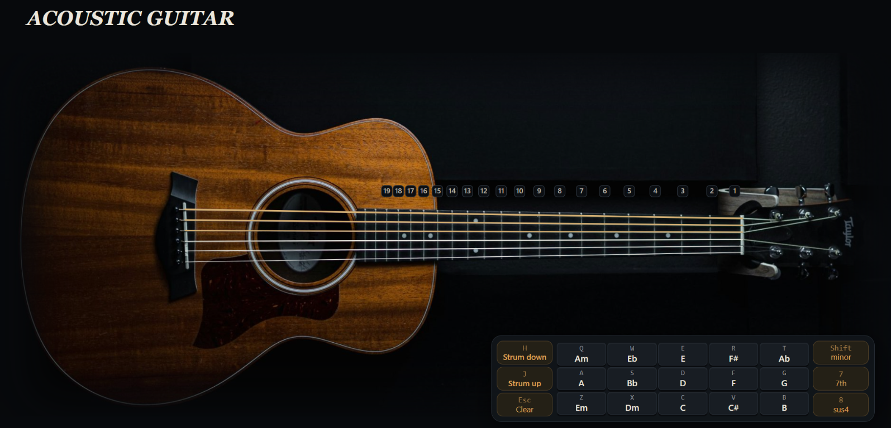

# Acoustic Guitar



A browser-based virtual acoustic guitar for strumming chords, exploring the
fretboard, and playing individual strings. Use the on-screen controls or your
keyboard to play.

On a phone, rotate to landscape to load the guitar and bring up the controls.

## Get started

Run the app from a local web server so the browser can load its audio samples
and JavaScript modules. In PowerShell, open this project folder and run:

```powershell
py -m http.server 8000
```

Open [http://localhost:8000](http://localhost:8000) in your browser. Leave the
server running while you use the app, and press `Ctrl+C` in PowerShell to stop
it.

## Controls

| Action | Mouse / touch | Keyboard |
| --- | --- | --- |
| Strum down | Select **Strum down** | `H` or `Space` |
| Strum up | Select **Strum up** | `J` |
| Play a chord | Select a chord key | `Q W E R T`, `A S D F G`, `Z X C V B` |
| Change chord quality | Select **minor**, **7th**, or **sus4** | Hold `Shift`, `7`, or `8` |
| Play a fretted note | Tap a string on the neck | — |
| Pluck one string | — | `1`–`6` (`1` is high E) |
| Clear the chord | Select **Clear** | `Esc` |

Clicking a chord-quality button toggles it on or off. Holding its keyboard
shortcut applies the modifier while the key is held.

## Project structure

```text
guitar/
├── index.html       # App page and control layout
├── style.css        # Page, guitar, and control styling
├── js/
│   ├── main.js      # App setup, keyboard controls, and chord pad
│   ├── guitar.js    # Guitar interaction, strings, and fretboard
│   ├── chords.js    # Chord definitions and voicings
│   └── audio.js     # Sample loading and playback
├── assets/
│   ├── guitar.jpg   # Guitar background
│   └── preview.png  # README screenshot
├── samples/         # Note samples used by the guitar
└── *.mp3            # Additional note samples
```

## Audio credits

The app uses sampled steel-string guitar audio from the FluidR3 GM soundfont,
distributed by
[gleitz/midi-js-soundfonts](https://github.com/gleitz/midi-js-soundfonts).
Samples are pitch-shifted to cover the playable frets.
